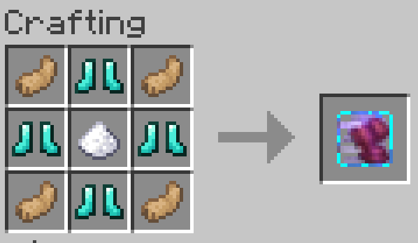
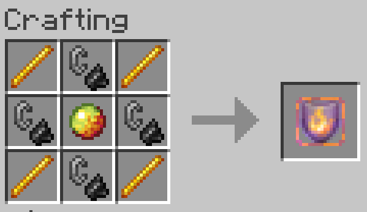
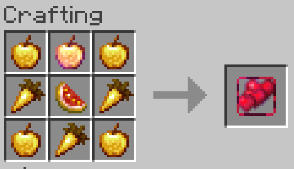
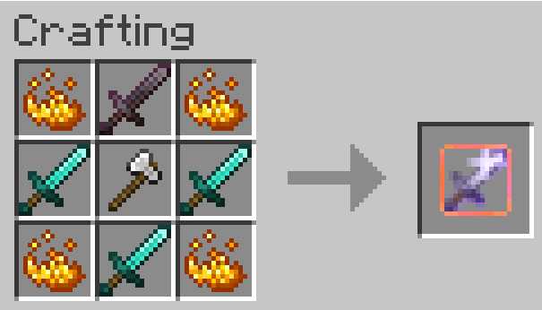
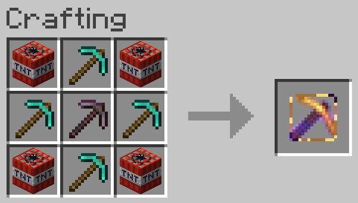
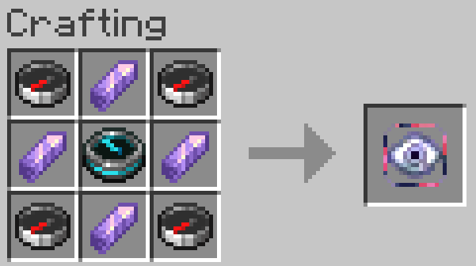
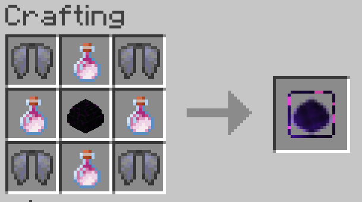

# AbilityEffects

A Minecraft mod that introduces unique ability items into the game. These abilities grant players powerful passive and active traits, transforming gameplay, PvP, and exploration.

---

## Core Features & Mechanics

*   **Permanent Binding:** Once an ability item is used, it is permanently attached to the player's data profile (via Data Attachments). It remains with the player until safely deactivated (Command: /ability drop) or lost.
*   **Double Ability Cap:** Players can have a maximum of **2 active abilities** simultaneously.
*   **PvP Death Penalty:** If a player is killed by another player in PvP, they **randomly drop one of their active abilities** as a physical item loot drop.
*   **Void Insurance:** If an ability item accidentally falls into the void, the global server counter is automatically refunded, making it safely craftable again.

---

## Included Abilities

<details>
  <summary><b>Speed Ability</b></summary>
  
  *   **Passive:** Grants a permanent **+50% movement speed** boost.
  *   **Active:** Propels the player forward in the direction they are looking, accompanied by a custom wind sound effect.

  

</details>


<details>
  <summary><b>Fire Resistance Ability</b></summary>

  *   **Passive:** Full immunity to all fire and lava damage.
  *   **Active:** Triggers a massive explosion (Strength 5.0) centered on the player (dealing zero damage to the user) and completely evaporates all water within a 10-block radius.

  

</details>


<details>
  <summary><b>Health Boost Ability</b></summary>

  *   **Passive:** Permanently grants **+25% maximum hearts**.
  *   **Active:** Instantly heals the player by 4 full hearts (8.0 HP).

  

</details>


<details>
  <summary><b>Feather Falling Ability</b></summary>

  *   **Passive:** Completely negates all fall damage.
  *   **Active:** Launches the player high up into the air with a powerful wind gust.

</details>


<details>
  <summary><b>Strength Ability</b></summary>

  *   **Passive:** Dynamically adds **+3.0 base attack damage**.
  *   **Active:** Grants the Strength II status effect for 10 seconds.

  

</details>


<details>
  <summary><b>Mining Ability</b></summary>

  *   **Passive:** Permanent **+30% mining efficiency**.
  *   **Active:** Enables instant-mining for 10 seconds (does not apply to Obsidian or Bedrock).

  

</details>


<details>
  <summary><b>Warden Ability</b></summary>

  *   **Passive:** Completely silences footsteps, blocking all block vibrations and sculk sensor inputs.
  *   **Active:** Fires a devastating sonic boom projectile up to 20 blocks away, dealing 13.0 damage and massive knockback to enemies.

</details>


<details>
  <summary><b>Wither Ability</b></summary>

  *   **Passive:** Attacks have a 10% chance to inflict the Wither effect on the target for 20 seconds.
  *   **Active:** Fires a horizontal fan-shot volley of 4 dangerous Wither skulls simultaneously.

</details>


<details>
  <summary><b>Pull Ability</b></summary>

  *   **Passive:** Attacks on players have a 10% chance to pull them directly towards you.
  *   **Active:** Continuously pulls all players within a massive 50-block radius to your exact position for 15 seconds.

</details>


<details>
  <summary><b>Tracker Ability</b></summary>

  *   **Passive:** Hitting a player automatically applies the Glowing effect to them for 60 seconds.
  *   **Active:** Opens a player selection GUI. Choosing an online player reveals their exact coordinates and projects a live, dynamic red laser beam from your eyes straight to the target. The laser automatically shuts off once you get within a 10-block radius or if the ability is lost.

  

</details>


<details>
  <summary><b>Ender Dragon Ability</b></summary>

  *   **Passive:** Consuming Dragon's Breath grants massive dynamic buffs (Regeneration, Resistance, Fire Resistance, Absorption) and returns an empty glass bottle.
  *   **Active:** Summons a rideable, fully controllable Ender Dragon for 10 seconds, steered entirely by your view direction.

  

</details>


---

## Controls & Keybinds

The mod features a clean client-side HUD overlay to monitor your current setup.
*   **[Key 1] (Default: Custom):** Triggers the active effect of your **first active ability**.
*   **[Key 2] (Default: Custom):** Triggers the active effect of your **second active ability** (e.g., opens the Tracker GUI).

> ⚠️ **Warning:** If a player joins a server without having the client-side mod installed, they can still craft items, but the HUD overlay and special ability keys will not function.

---

## Commands

*   `/ability help` – Opens the comprehensive multi-page technical documentation guide in chat.
*   `/ability craftable` – Opens a synchronized GUI showing global item limits and remaining crafting slots.
*   `/ability drop <ability>` – Safely deactivates an active ability and returns it to your inventory as an item.

---

### Building the Project
This project uses standard Gradle resource packaging.

To compile and build the mod `.jar` file, run:
```bash
./gradlew build
```
The compiled file will be located inside `build/libs/`.

## Contribute

Feel free to open an issue for bugs or feature requests!

